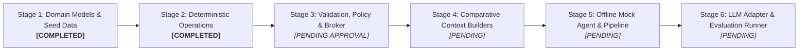

# ShopConnect Implementation Status & Verification Report

**Environment Runtime:** Python 3.14.7 (`.venv`)  
**Package Name:** `shopconnect_env`  
**Current Test Coverage:** 19 Passed / 0 Failed (100% pass rate)  
**Last Verification Run:** 2026-11-07  
**Master Specification:** [docs/RESEARCH_SPEC.md](RESEARCH_SPEC.md)

---

## 1. Research Objective

The ShopConnect Object-Centric Intelligence Environment investigates whether an LLM can effectively interact with persistent Python domain objects using **compact method signatures and selective progressive disclosure**, rather than repeatedly receiving and regenerating the entire application state on every turn.

The system establishes a deterministic **trust boundary**:
* The LLM proposes candidate actions via structured payloads.
* Authoritative application code stages changes on an isolated candidate copy, validates all domain invariants, recalculates derived projections, and commits or rolls back atomically.

---

## 2. Stage 1 Implementation: Domain Models & Seed Catalog

Stage 1 established the authoritative domain data layer. All models are implemented as pure Python `@dataclass` structures with zero dependencies on external frameworks, databases, or language models.

### 2.1 Domain Models ([`src/shopconnect_env/domain/models.py`](../src/shopconnect_env/domain/models.py))

* **`Ingredient` (Frozen Dataclass):** Represents a canonical raw ingredient with a unique string ID (`ingredient_id`), human-readable name, category (e.g., `'Produce'`, `'Grains'`), and canonical measurement unit (`'g'`, `'ml'`, `'unit'`). Immutability ensures standard units cannot be modified in place.
* **`IngredientRequirement` (Frozen Dataclass):** Specifies the required quantity (`Decimal`) and unit for an ingredient within a recipe. Provides a pure `scale(factor: Decimal) -> IngredientRequirement` method.
* **`Recipe` (Dataclass):** The blueprint for a meal. Defines `recipe_id`, `name`, dietary/meal `tags`, `default_servings`, `estimated_cost` (in USD using `Decimal`), and a list of `requirements`. Exposes a computed property `cost_per_serving = estimated_cost / Decimal(default_servings)`.
* **`Meal` (Dataclass):** Represents a scheduled slot. Associates a calendar day (`'Monday'`–`'Sunday'`) and meal type (`'breakfast'`, `'lunch'`, `'dinner'`) with a `recipe_id` and specific portion size (`servings`). Exposes `slot_key` (e.g., `'Wednesday_dinner'`) and `calculate_cost(recipe)`.
* **`UserPreferences` (Dataclass):** Encapsulates household constraints: required `diet_tags` (e.g., `['vegetarian']`), excluded `allergies` (e.g., `['peanuts']`), a positive `weekly_budget` (`Decimal`), and `household_size`.
* **`MealPlan` (Dataclass):** The central state entity representing the full 7-day schedule (up to 21 distinct slots). Tracks monotonic `plan_version`, preferences, and meal slots. Provides `set_meal()`, `get_meal(day, meal_type)`, `is_complete()`, and `calculate_total_cost(catalog)`.
* **`GroceryItem` (Frozen Dataclass):** Represents an aggregated shopping item containing canonical ID, display name, aisle category, total quantity (`Decimal`), and unit.
* **`GroceryBasket` (Frozen Dataclass):** An immutable, purely derived projection of ingredients required by all active meals in a `MealPlan`. Enforces the critical research rule that **the grocery basket is never directly editable by an LLM**.

### 2.2 Seed Catalog ([`data/catalog_seed.json`](../data/catalog_seed.json))

A curated dataset containing:
* **31 Canonical Ingredients:** Covering produce, grains, legumes, dairy, plant proteins, meats, seafood, oils, and seasonings with standardized units (`g`, `ml`, `unit`, `slice`).
* **18 Realistic Recipes:** Spanning breakfasts, lunches, and dinners, with diverse dietary tags (`vegetarian`, `vegan`, `gluten-free`, `dairy-free`, `high-protein`, `quick`) and documented costs.
* **Referential Integrity Loader:** `load_catalog_from_json(path)` validates that every recipe requirement references an existing canonical ingredient ID and converts all numerical values to `Decimal`.

---

## 3. Stage 2 Implementation: Deterministic Operations & Derived Basket

Stage 2 implemented deterministic state mutations and pure derived state recalculation, ensuring strict candidate state isolation.

### 3.1 State Mutations ([`src/shopconnect_env/operations/mutations.py`](../src/shopconnect_env/operations/mutations.py))

* **`apply_replace_meal(plan, day, meal_type, recipe_id, catalog, servings=None)`:**
  * Validates slot key formatting via `make_slot_key(day, meal_type)`.
  * Verifies target `recipe_id` exists in the recipe catalog (raises `KeyError` if missing).
  * Validates serving portion (must be a positive integer; defaults to `recipe.default_servings` if omitted).
  * **Candidate Staging:** Uses `copy.deepcopy(plan)` to isolate changes.
  * Mutates only the target slot; leaves all 20 other slots byte-identical.
  * Increments `plan_version` on the returned candidate.
* **`apply_change_servings(plan, day, meal_type, servings)`:**
  * Verifies the target slot is currently scheduled (raises `KeyError` if empty).
  * Validates that `servings` is a positive integer.
  * Clones the plan, modifies portion size, and advances `plan_version`.

### 3.2 Derived Basket Aggregator ([`src/shopconnect_env/operations/basket_calculator.py`](../src/shopconnect_env/operations/basket_calculator.py))

* **`calculate_grocery_basket(plan, catalog, ingredients)`:**
  * Pure calculation engine that inspects every scheduled meal in the provided `MealPlan`.
  * Evaluates scaling ratio:
    $$\text{scale\_factor} = \frac{\text{meal.servings}}{\text{recipe.default\_servings}}$$
  * Multiplies each requirement by $\text{scale\_factor}$ with exact `Decimal` precision.
  * Aggregates identical ingredients across different recipes (e.g., spinach in an omelet and pasta).
  * Verifies unit compatibility across recipes (raises `ValueError` on unit conflict).
  * Verifies referential integrity (raises `KeyError` if a recipe or ingredient is missing from catalogs).
  * Sorts output items alphabetically by `ingredient_id` for deterministic, reproducible comparisons.
  * Returns an immutable `GroceryBasket` with `basket_version == plan.plan_version`.

---

## 4. Current Function & Module Catalog

| Module | Implemented Class / Function | Signature | Operational Role |
| :--- | :--- | :--- | :--- |
| `domain.models` | `make_slot_key` | `(day: str, meal_type: str) -> str` | Canonical slot identifier (e.g. `'Monday_breakfast'`). |
| `domain.models` | `Ingredient` | `@dataclass(frozen=True)` | Immutable canonical grocery item. |
| `domain.models` | `IngredientRequirement` | `@dataclass(frozen=True)` | Quantity, unit, and `scale(factor)` method. |
| `domain.models` | `Recipe` | `@dataclass` | Recipe definition, tags, and `cost_per_serving`. |
| `domain.models` | `Meal` | `@dataclass` | Scheduled slot, servings, and `calculate_cost`. |
| `domain.models` | `UserPreferences` | `@dataclass` | Dietary tags, allergen exclusions, and budget cap. |
| `domain.models` | `MealPlan` | `@dataclass` | 7-day schedule, 21 slots, `plan_version`. |
| `domain.models` | `GroceryBasket` | `@dataclass(frozen=True)` | Immutable derived shopping list. |
| `domain.models` | `load_catalog_from_json` | `(filepath: Path \| str) -> Tuple[Dict, Dict]` | Parses seed JSON into typed models with `Decimal`. |
| `operations.mutations` | `apply_replace_meal` | `(plan, day, meal_type, recipe_id, catalog, servings=None) -> MealPlan` | Pure meal slot replacement on cloned candidate. |
| `operations.mutations` | `apply_change_servings` | `(plan, day, meal_type, servings: int) -> MealPlan` | Pure portion size scaling on cloned candidate. |
| `operations.basket_calculator` | `calculate_grocery_basket` | `(plan, catalog, ingredients) -> GroceryBasket` | Pure, deterministic grocery aggregation engine. |

---

## 5. Verification: Passing Automated Test Suite

Executed via `.\.venv\Scripts\python.exe -m pytest -v`:

```text
============================= test session starts =============================
platform win32 -- Python 3.14.7, pytest-9.2.0, pluggy-1.7.0 -- .venv\Scripts\python.exe
rootdir: C:\Users\deepu\OneDrive\Desktop\shopconnect-object-env
configfile: pytest.ini
testpaths: tests
collecting ... collected 19 items

tests/test_domain_models.py::test_ingredient_creation PASSED             [  5%]
tests/test_domain_models.py::test_ingredient_requirement_and_scaling PASSED [ 10%]
tests/test_domain_models.py::test_recipe_cost_per_serving PASSED         [ 15%]
tests/test_domain_models.py::test_meal_slot_keys_and_validation PASSED   [ 21%]
tests/test_domain_models.py::test_meal_cost_calculation PASSED           [ 26%]
tests/test_domain_models.py::test_meal_plan_slot_representation PASSED   [ 31%]
tests/test_domain_models.py::test_user_preferences_defaults PASSED       [ 36%]
tests/test_domain_models.py::test_load_catalog_seed PASSED               [ 42%]
tests/test_domain_models.py::test_derived_grocery_basket_calculation PASSED [ 47%]
tests/test_operations.py::test_replace_wednesday_dinner PASSED           [ 52%]
tests/test_operations.py::test_other_slots_remain_unchanged PASSED       [ 57%]
tests/test_operations.py::test_change_servings PASSED                    [ 63%]
tests/test_operations.py::test_ingredient_quantity_scaling PASSED        [ 68%]
tests/test_operations.py::test_aggregating_shared_ingredients PASSED     [ 73%]
tests/test_operations.py::test_missing_recipe_id_error PASSED            [ 78%]
tests/test_operations.py::test_unknown_meal_slot_error PASSED            [ 84%]
tests/test_operations.py::test_invalid_serving_counts PASSED             [ 89%]
tests/test_operations.py::test_original_plan_unchanged_on_failure PASSED [ 94%]
tests/test_operations.py::test_recalculate_basket_after_replacement PASSED [100%]

============================= 19 passed in 0.15s ==============================
```

### Invariants Proven by Test Results:
1. **Financial & Quantitative Precision:** Zero floating-point rounding errors across all calculations.
2. **Referential Integrity:** 100% of recipe requirements reference valid canonical ingredients.
3. **State Isolation:** Operations operate exclusively on candidate clones; failed operations leave original plans byte-identical.
4. **Preservation of Non-Target Slots:** Modifying Wednesday dinner leaves all other scheduled days untouched.
5. **Deterministic Aggregation:** Recalculating the grocery basket combines shared ingredients across meals and purges ingredients from replaced meals.

---

## 6. Implementation Stages & Current Roadmap



| Stage | Focus Area | Status | Planned Modules |
| :--- | :--- | :---: | :--- |
| **Stage 1** | Core Domain Models & Seed Catalog | **Completed** | `domain/models.py`, `catalog_seed.json` |
| **Stage 2** | Deterministic Operations & Basket Math | **Completed** | `operations/mutations.py`, `operations/basket_calculator.py` |
| **Stage 3** | Validation, PolicyEngine & ActionBroker | *Pending Approval* | `validation/schemas.py`, `validation/policy_engine.py`, `validation/broker.py` |
| **Stage 4** | Comparative Context Strategies (A, B, C) | *Pending* | `context/full_state.py`, `context/tool_context.py`, `context/object_context.py` |
| **Stage 5** | Offline Mock Agent & Test Pipeline | *Pending* | `agents/base.py`, `agents/mock_agent.py`, `tests/test_offline_pipeline.py` |
| **Stage 6** | Real LLM Adapter, Tasks & Benchmark Runner | *Pending* | `agents/llm_adapter.py`, `evaluation/runner.py`, `results/comparison.csv` |

---

## 7. Current System Limitations

The environment currently exhibits the following documented boundaries:
1. **No Runtime Policy Enforcement Yet:** Operations validate syntax, coordinates, and recipe existence, but do not yet evaluate user budget ceilings or allergen tags (scheduled for Stage 3 `PolicyEngine`).
2. **No Untrusted JSON Action Ingestion:** Operations currently accept native Python parameters. Parsing and schema validation of untrusted LLM action proposals will be handled in Stage 3 (`schemas.py`).
3. **No Context Serialization:** Context generators for Conditions A, B, and C are not yet built (scheduled for Stage 4).
4. **In-Memory State Store:** State resides in Python memory during execution; SQLite persistence is deferred to future hardening.

---

## 8. Next Development Milestones (Stage 3 Preview)

Upon mentor authorization, Stage 3 will implement:
1. **Pydantic Action Schemas (`validation/schemas.py`):**
   * `ActionProposal`: Standardized schema for incoming model actions (`operation`, `arguments`, `reason`).
   * `ReplaceMealArgs`, `ChangeServingsArgs`, `InspectObjectArgs`.
   * `ActionResult`: Status (`COMMITTED` vs `REJECTED`), plan versions before/after, rejection reason, execution duration.
2. **Policy Engine (`validation/policy_engine.py`):**
   * Deterministic checking of dietary compliance (e.g., rejecting meat for vegetarian profiles).
   * Budget ceiling checks against weekly expenditure limits.
   * Postcondition invariant verification (asserting 0 unintended mutations).
3. **Action Broker (`validation/broker.py`):**
   * Transaction coordinator: stages candidate state, invokes policy checks, recomputes derived grocery basket, and executes atomic commit or rollback.
