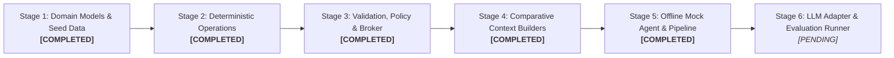

# ShopConnect Implementation Status & Verification Report

**Environment Runtime:** Python 3.14.7 (`.venv`)  
**Package Name:** `shopconnect_env`  
**Current Test Coverage:** 105 Passed / 0 Failed (100% pass rate)
**Last Verification Run:** 2026-11-10
**Master Specification:** [docs/RESEARCH_SPEC.md](RESEARCH_SPEC.md)

---

## 1. Research Objective

The ShopConnect Object-Centric Intelligence Environment investigates whether an LLM can effectively interact with persistent Python domain objects using **compact method signatures and selective progressive disclosure**, rather than repeatedly receiving and regenerating the entire application state on every turn.

The system enforces a strict, deterministic **trust boundary**:
* The LLM acts solely as an untrusted proposer emitting structured JSON payloads.
* Trusted application code parses schemas, stages candidates on isolated clones, enforces dietary/allergen/budget policy gates, recomputes derived projections, and commits or rolls back atomically.

---

## 2. Stage 1 Implementation: Domain Models & Seed Catalog

Stage 1 established the authoritative domain data layer as pure Python `@dataclass` structures with zero dependencies on external frameworks, databases, or language models.

### 2.1 Domain Models ([`src/shopconnect_env/domain/models.py`](../src/shopconnect_env/domain/models.py))

* **`Ingredient` (Frozen Dataclass):** Represents a canonical raw ingredient with a unique string ID (`ingredient_id`), human-readable display name, aisle category, canonical measurement unit, and an optional tuple of verified allergen classifications (`allergens`). Immutability ensures standard units and allergen declarations cannot be modified in place.
* **`IngredientRequirement` (Frozen Dataclass):** Specifies the required quantity (`Decimal`) and unit for an ingredient within a recipe. Provides a pure `scale(factor: Decimal) -> IngredientRequirement` method.
* **`Recipe` (Dataclass):** The blueprint for a meal. Defines `recipe_id`, `name`, dietary/meal `tags`, `default_servings`, `estimated_cost` (in USD using `Decimal`), and a list of `requirements`. Exposes a computed property `cost_per_serving = estimated_cost / Decimal(default_servings)`.
* **`Meal` (Dataclass):** Represents a scheduled slot. Associates a calendar day (`'Monday'`–`'Sunday'`) and meal type (`'breakfast'`, `'lunch'`, `'dinner'`) with a `recipe_id` and specific portion size (`servings`). Exposes `slot_key` (e.g., `'Wednesday_dinner'`) and `calculate_cost(recipe)`.
* **`UserPreferences` (Dataclass):** Encapsulates household constraints: required `diet_tags` (e.g., `['vegetarian']`), excluded `allergies` (e.g., `['peanuts']`), a positive `weekly_budget` (`Decimal`), and `household_size`.
* **`MealPlan` (Dataclass):** The central state entity representing the full 7-day schedule (up to 21 distinct slots). Tracks monotonic `plan_version`, preferences, and meal slots. Provides `set_meal()`, `get_meal(day, meal_type)`, `is_complete()`, and `calculate_total_cost(catalog)`.
* **`GroceryItem` (Frozen Dataclass):** Represents an aggregated shopping item containing canonical ID, display name, aisle category, total quantity (`Decimal`), and unit.
* **`GroceryBasket` (Frozen Dataclass):** An immutable, purely derived projection of ingredients required by all active meals in a `MealPlan`. Enforces the critical research rule that **the grocery basket is never directly editable by an LLM**.

### 2.2 Seed Catalog ([`data/catalog_seed.json`](../data/catalog_seed.json))

A curated dataset containing:
* **31 Canonical Ingredients:** Covering produce, grains, legumes, dairy, plant proteins, meats, seafood, oils, and seasonings with standardized units (`g`, `ml`, `unit`, `slice`) and canonical allergen classifications (`peanuts`, `tree_nuts`, `eggs`, `dairy`, `soy`, `wheat`, `gluten`, `fish`).
* **18 Realistic Recipes:** Spanning breakfasts, lunches, and dinners, with diverse dietary tags (`vegetarian`, `vegan`, `gluten-free`, `dairy-free`, `high-protein`, `quick`) and documented costs.
* **Referential Integrity Loader:** `load_catalog_from_json(path)` validates that every recipe requirement references an existing canonical ingredient ID, normalizes allergens into immutable tuples, and converts all numerical values to `Decimal`.

---

## 3. Stage 2 Implementation: Deterministic Operations & Derived Basket

Stage 2 implemented deterministic state mutations and pure derived state recalculation, ensuring strict candidate state isolation.

### 3.1 State Mutations ([`src/shopconnect_env/operations/mutations.py`](../src/shopconnect_env/operations/mutations.py))

* **`apply_replace_meal(plan, day, meal_type, recipe_id, catalog, servings=None)`:**
  * Validates slot key formatting via `make_slot_key(day, meal_type)`.
  * Verifies target `recipe_id` exists in the recipe catalog (raises `KeyError` if missing).
  * Validates serving portion (must be a positive integer; defaults to `recipe.default_servings` if omitted).
  * **Candidate Staging:** Uses `copy.deepcopy(plan)` to isolate changes.
  * Mutates only the target slot; leaves all 20 other slots byte-identical.
  * Increments `plan_version` on the returned candidate.
* **`apply_change_servings(plan, day, meal_type, servings)`:**
  * Verifies the target slot is currently scheduled (raises `KeyError` if empty).
  * Validates that `servings` is a positive integer.
  * Clones the plan, modifies portion size, and advances `plan_version`.

### 3.2 Derived Basket Aggregator ([`src/shopconnect_env/operations/basket_calculator.py`](../src/shopconnect_env/operations/basket_calculator.py))

* **`calculate_grocery_basket(plan, catalog, ingredients)`:**
  * Pure calculation engine that inspects every scheduled meal in the provided `MealPlan`.
  * Evaluates scaling ratio:
    $$\text{scale\_factor} = \frac{\text{meal.servings}}{\text{recipe.default\_servings}}$$
  * Multiplies each requirement by $\text{scale\_factor}$ with exact `Decimal` precision.
  * Aggregates identical ingredients across different recipes (e.g., spinach in an omelet and pasta).
  * Verifies unit compatibility across recipes (raises `ValueError` on unit conflict).
  * Verifies referential integrity (raises `KeyError` if a recipe or ingredient is missing from catalogs).
  * Sorts output items alphabetically by `ingredient_id` for deterministic, reproducible comparisons.
  * Returns an immutable `GroceryBasket` with `basket_version == plan.plan_version`.

---

## 4. Stage 3 Implementation: Validation, Policy Engine & Action Broker

Stage 3 established the deterministic safety and transactional coordination layer that governs all interactions with domain state.

### 4.1 Pydantic Action Schemas ([`src/shopconnect_env/validation/schemas.py`](../src/shopconnect_env/validation/schemas.py))

* **`OperationType` (Enum):** Explicit allowlist of permissible operations: `replace_meal`, `change_servings`, and `inspect_object`.
* **`ReplaceMealArgs` & `ChangeServingsArgs`:** Strict models configured with `ConfigDict(extra="forbid")`. Enforces valid day (`DAYS_OF_WEEK`), valid slot (`MEAL_TYPES`), non-empty recipe IDs, and positive integer servings. Explicitly rejects floats (e.g., `2.5`, `3.0`) and booleans (`True`, `False`).
* **`InspectObjectArgs`:** Defines queries against entity categories (`recipe`, `meal`, `plan`, `preferences`, `ingredient`).
* **`ActionProposal`:** Root schema ingesting untrusted agent proposals from JSON strings or Python dictionaries. Validates that arguments strictly conform to the declared operation. Supports `expected_plan_version` for stale-state protection and requires a human-readable `reason`.
* **`ActionResult`:** Standardized return payload capturing execution status (`COMMITTED` vs `REJECTED`), version deltas, execution duration in milliseconds, rejection reasons, and diagnostic details.

### 4.2 Policy Engine ([`src/shopconnect_env/validation/policy_engine.py`](../src/shopconnect_env/validation/policy_engine.py))

* **Dietary Restrictions:** Validates that every scheduled recipe satisfies all configured `UserPreferences.diet_tags` (with support for implicit tags such as `vegan` implying `vegetarian` and `dairy-free`).
* **Allergen Safety & Conservative Handling:**
  * Normalizes aliases across common categories (e.g., `peanut`/`peanuts`, `milk`/`dairy`, `wheat`/`gluten`, `egg`/`eggs`, `nut`/`tree_nuts`).
  * Cross-references ingredient requirements against user allergies.
  * **Conservative Rule:** If an ingredient has unknown allergen metadata (`allergens is None`) while the user has active allergy constraints, the recipe is conservatively rejected.
* **Weekly Budget Enforcement:** Recomputes projected total costs of all scheduled meals using `Decimal` arithmetic. Rejects candidates that exceed `UserPreferences.weekly_budget`.
* **State Invariant Validation:** Asserts that user preferences are unchanged, the plan version increments exactly by 1, non-target slots remain byte-identical, and no unauthorized meal slots are created.

### 4.3 Action Broker & Atomic State Management ([`src/shopconnect_env/validation/broker.py`](../src/shopconnect_env/validation/broker.py))

* **Private Runtime State (`RuntimeState`):** Holds private, immutable references to the authoritative `MealPlan` and matching `GroceryBasket`.
* **State Encapsulation:** `get_plan()` returns an isolated `copy.deepcopy()` snapshot so external callers cannot mutate internal state.
* **Atomic Transaction Lifecycle:**
  1. Ingests raw proposal, JSON string, or dictionary.
  2. Parses schema; rejects malformed syntax, extra fields, or unsupported operations.
  3. Validates `expected_plan_version` against authoritative state; rejects stale requests.
  4. Stages candidate `MealPlan` using deterministic operations (`apply_replace_meal`, `apply_change_servings`).
  5. Evaluates pre-commit policy rules (dietary, allergen, budget, invariants).
  6. Recalculates derived `GroceryBasket`.
  7. Verifies postconditions (basket version matches plan version).
  8. Commits state atomically via a single reference swap (`self._state = RuntimeState(...)`).
  9. On any error, aborts transaction immediately. Authoritative state remains completely untouched.

---

## 5. Stage 4 Implementation: Comparative Context Strategies (Conditions A, B & C)

Stage 4 implemented three independent, read-only context construction strategies to benchmark how different interaction architectures affect LLM token consumption, latency, and state preservation.

### 5.1 Shared Architecture & Protocol ([`src/shopconnect_env/context/base.py`](../src/shopconnect_env/context/base.py))
* **`ContextRequest`:** Standardized input dataclass holding `user_request`, `plan`, `catalog`, `ingredients`, optional `basket` (auto-derived if omitted), and optional `target_day` and `target_meal_type`.
* **`ContextResult`:** Standardized output dataclass returning `condition`, `condition_id`, `system_prompt`, `task_prompt`, `signatures`, `serialized_context`, and `metadata`.
* **Deterministic Serializers:** Pure functions guaranteeing stable key ordering (`sort_keys=True`), canonical slot sequencing (`serialize_all_21_slots`), and exact string representation for monetary and quantity values (`serialize_decimal`).
* **Read-Only Invariant:** Context builders operate strictly on deep copies and never mutate authoritative state.

### 5.2 Condition A: Full-State Regeneration ([`src/shopconnect_env/context/full_state.py`](../src/shopconnect_env/context/full_state.py))
* **Monolithic Baseline:** Exposes the entire application state in a single JSON payload.
* **Content Serialized:**
  1. All 7 days and 21 slots in canonical order (Monday breakfast through Sunday dinner), with explicit `status: "unfilled"` representation for unscheduled slots.
  2. Detailed recipe definitions for all active meals in the plan, including complete ingredient requirements, quantities, units, tags, and costs.
  3. Complete recipe catalog of all available recipes.
  4. Full canonical ingredient catalog (all 31 ingredients with standard units and allergen classifications).
  5. Current derived `GroceryBasket` and `basket_version`.
  6. `plan_id`, `plan_version`, and full `UserPreferences`.
* **Interaction Modality:** The agent is instructed to read the entire state and re-emit the complete 7-day schedule. No tools or progressive signatures are provided (`signatures = None`).

### 5.3 Condition B: Conventional Flat Tool-Calling ([`src/shopconnect_env/context/tool_context.py`](../src/shopconnect_env/context/tool_context.py))
* **Industry Baseline:** Implements standard function-calling schemas (matching OpenAI/Anthropic tool interfaces).
* **Content Serialized:**
  1. Flat tool specifications for `replace_meal` and `change_servings`, directly embedding JSON schemas generated from Stage 3 Pydantic models (`ReplaceMealArgs.model_json_schema()` and `ChangeServingsArgs.model_json_schema()`).
  2. Structured application state snapshot containing currently assigned meals, high-level recipe metadata (names, tags, costs), user preferences, and a grocery basket summary.
* **Boundaries:** Does not expose raw ingredient tables, granular ingredient requirement breakdowns, or Condition C's progressive inspection methods.

### 5.4 Condition C: Object-Centric Progressive Disclosure ([`src/shopconnect_env/context/object_context.py`](../src/shopconnect_env/context/object_context.py))
* **Proposed Research Condition:** Exposes compact Python domain class signatures and progressive disclosure rather than monolithic JSON state dumps.
* **Initial Context:**
  1. Authoritative domain object stubs: `MealPlan`, `Recipe`, `Ingredient`, and `UserPreferences` with attributes and read-only accessors (`get_meal`, `calculate_total_cost`, `is_complete`).
  2. Clearly defined mutating operations executed as allowlisted `ActionProposal` submissions to the Stage 3 `ActionBroker` (`replace_meal`, `change_servings`).
  3. User preferences and constraints (`diet_tags`, `allergies`, `weekly_budget`, `household_size`).
  4. Target slot summary (e.g. `Wednesday_dinner` current recipe, servings, and cost) if target coordinates are provided.
  5. Clear usage instructions for on-demand read-only inspection operations.
* **Progressive Inspection API:**
  - `inspect_slot(day, meal_type) -> Dict[str, Any]`: Queries meal assigned to a specific schedule slot.
  - `inspect_recipe(recipe_id) -> Dict[str, Any]`: Queries recipe metadata, tags, servings, and costs.
  - `inspect_recipe_ingredients(recipe_id) -> Dict[str, Any]`: Queries ingredient requirements for a recipe.
  - `inspect_ingredient(ingredient_id) -> Dict[str, Any]`: Queries canonical ingredient details and allergen classifications.
  - `inspect_plan() -> Dict[str, Any]`: Queries active plan metadata, plan_version, and total assigned meal count.
  - `inspect_preferences() -> Dict[str, Any]`: Queries household dietary constraints, allergy restrictions, and weekly budget.
  - `inspect(target_type, target_id, day, meal_type) -> Dict[str, Any]`: Unified dispatcher matching `InspectObjectArgs`.
* **Disclosure Tracking & Audit Log:**
  - Every successful inspection records `disclosure_id`, `object_type`, `object_id`, `status`, `summary`, and `revealed_fields`.
  - Exposes `get_disclosure_log()`, `get_disclosure_count()`, and `reset_disclosure_log()` for precise empirical token and disclosure accounting.

---

## 6. Stage 5 Implementation: Offline MockAgent & Common Agent Interface

Stage 5 implemented the offline agent layer, establishing the common interface protocol for both offline deterministic agents and future live LLM adapters.

### 6.1 Agent Contracts & Protocols ([`src/shopconnect_env/agents/base.py`](../src/shopconnect_env/agents/base.py))

* **`ObjectInspector` (`Protocol`):** Narrow, read-only interface (`inspect_slot`, `inspect_recipe`, `inspect_recipe_ingredients`, `inspect_ingredient`, `inspect_plan`, `inspect_preferences`, `inspect`) natively satisfied by `ObjectContextBuilder`. In Condition C, the exact builder instance that built the context is passed as the inspector, guaranteeing that progressive disclosures are audited in the builder's log.
* **`AgentResponse` (`@dataclass(frozen=True)`):** Standardized response container returning `proposal` (`Optional[ActionProposal]`), brief `rationale`, deterministic `raw_output` (serialized JSON of proposal), `inspection_calls_made` counter, and `metadata`.
* **`BaseAgent` (`ABC`):** Abstract protocol defining `propose_action(context: ContextResult, inspector: Optional[ObjectInspector] = None) -> AgentResponse`. The task is derived strictly from `context.task_prompt`.

### 6.2 Deterministic MockAgent ([`src/shopconnect_env/agents/mock_agent.py`](../src/shopconnect_env/agents/mock_agent.py))

* **Strict Version Safety:** `_extract_plan_version` validates that `plan_version` in `context.serialized_context` is a strictly positive integer. Safely rejects missing, boolean, float, string, zero, or negative versions (`has_proposal = False`).
* **Deterministic Command Grammar:**
  * `replace <day> <slot> with <recipe_id>` (with optional servings).
  * `change servings for <day> <slot> to <N>`.
  * `replace <day> <slot> with <tag> recipe`: For Conditions A & B, filters recipes by both dietary tag and meal slot category, sorting alphabetically by `recipe_id` as a deterministic tie-breaker (e.g. vegetarian Tuesday lunch resolves to `rec_black_bean_quinoa_bowl`). For Condition C, requires an exact recipe ID or canned fixture (preserving the rule that Condition C context exposes no raw catalog search).
* **Semantic Rejection Fixtures:**
  * `TEST_NONEXISTENT_RECIPE`: Valid `ReplaceMealArgs` with unknown `rec_nonexistent`; rejected at broker staging.
  * `TEST_ALLERGEN_CONFLICT`: Proposes `rec_peanut_butter_banana_toast` in a breakfast slot for a household with peanut allergies; rejected specifically by `PolicyEngine`.
  * `TEST_BUDGET_OVERFLOW`: Proposes `rec_pan_seared_salmon` ($14.50) against a controlled $10.00 weekly budget; rejected specifically by `PolicyEngine` budget check.
  * `TEST_STALE_VERSION`: Sets `expected_plan_version = plan_version + 999`; intercepted and rejected at broker Step 3.
* **Canned Task Fixtures:** Supports registering arbitrary custom task mappings.
* **Unsupported Task Protection:** Unrecognized commands return `has_proposal = False` with zero broker invocation and zero state mutation.

### 6.3 Scientific Scope & Boundary Note

Stage 5 serves as an offline integration and compatibility harness across all three context builders. Condition A context currently instructs full-state text regeneration, whereas Stage 5's common `ActionProposal` interface tests single targeted operations. Faithful full-state regeneration parsing and comparative drift evaluation are explicitly deferred to Stage 6.

---

## 7. Current Function & Module Catalog

| Module | Implemented Class / Function | Signature | Operational Role |
| :--- | :--- | :--- | :--- |
| `domain.models` | `make_slot_key` | `(day: str, meal_type: str) -> str` | Canonical slot identifier (e.g. `'Monday_breakfast'`). |
| `domain.models` | `Ingredient` | `@dataclass(frozen=True)` | Immutable canonical grocery item with allergen tuple. |
| `domain.models` | `IngredientRequirement` | `@dataclass(frozen=True)` | Quantity, unit, and `scale(factor)` method. |
| `domain.models` | `Recipe` | `@dataclass` | Recipe definition, tags, and `cost_per_serving`. |
| `domain.models` | `Meal` | `@dataclass` | Scheduled slot, servings, and `calculate_cost`. |
| `domain.models` | `UserPreferences` | `@dataclass` | Dietary tags, allergen exclusions, and budget cap. |
| `domain.models` | `MealPlan` | `@dataclass` | 7-day schedule, 21 slots, `plan_version`. |
| `domain.models` | `GroceryBasket` | `@dataclass(frozen=True)` | Immutable derived shopping list. |
| `domain.models` | `load_catalog_from_json` | `(filepath: Path \| str) -> Tuple[Dict, Dict]` | Parses seed JSON into typed models with `Decimal`. |
| `operations.mutations` | `apply_replace_meal` | `(plan, day, meal_type, recipe_id, catalog, servings=None) -> MealPlan` | Pure meal slot replacement on cloned candidate. |
| `operations.mutations` | `apply_change_servings` | `(plan, day, meal_type, servings: int) -> MealPlan` | Pure portion size scaling on cloned candidate. |
| `operations.basket_calculator` | `calculate_grocery_basket` | `(plan, catalog, ingredients) -> GroceryBasket` | Pure, deterministic grocery aggregation engine. |
| `validation.schemas` | `ReplaceMealArgs` | `BaseModel` | Validates replace_meal arguments with strict type checks. |
| `validation.schemas` | `ChangeServingsArgs` | `BaseModel` | Validates change_servings arguments with strict integer checks. |
| `validation.schemas` | `InspectObjectArgs` | `BaseModel` | Validates read-only object inspection queries. |
| `validation.schemas` | `ActionProposal` | `BaseModel` | Validates incoming action proposal payloads. |
| `validation.schemas` | `ActionResult` | `BaseModel` | Authoritative transaction execution result. |
| `validation.policy_engine` | `PolicyEngine` | `class` | Deterministic dietary, allergen, budget, and invariant checker. |
| `validation.broker` | `ActionBroker` | `class` | Transaction staging, atomic commit, and rollback coordinator. |
| `context.base` | `ContextRequest` | `@dataclass(frozen=True)` | Standardized input payload for context construction. |
| `context.base` | `ContextResult` | `@dataclass(frozen=True)` | Standardized output payload for context builders. |
| `context.base` | `serialize_all_21_slots` | `(plan, catalog) -> List[Dict]` | Deterministic 21-slot serialization with unfilled markers. |
| `context.full_state` | `FullStateContextBuilder` | `BaseContextBuilder` | Monolithic Condition A full-state serialization builder. |
| `context.tool_context` | `ToolContextBuilder` | `BaseContextBuilder` | Flat Condition B tool-calling schema and snapshot builder. |
| `context.object_context` | `ObjectContextBuilder` | `BaseContextBuilder` | Compact Condition C progressive disclosure builder & inspector. |
| `agents.base` | `ObjectInspector` | `Protocol` | Narrow read-only inspection protocol for Condition C. |
| `agents.base` | `AgentResponse` | `@dataclass(frozen=True)` | Standardized agent response container with proposal and metadata. |
| `agents.base` | `BaseAgent` | `ABC` | Abstract agent protocol defining `propose_action(context, inspector)`. |
| `agents.mock_agent` | `MockAgent` | `BaseAgent` | Deterministic offline agent with grammar, version checks, and fixtures. |

---

## 8. Verification: Passing Automated Test Suite (105 Tests)

Executed via `.\.venv\Scripts\python.exe -m pytest -v`:

```text
============================= test session starts =============================
platform win32 -- Python 3.14.7, pytest-9.2.0, pluggy-1.7.0 -- .venv\Scripts\python.exe
rootdir: C:\Users\deepu\OneDrive\Desktop\shopconnect-object-env
configfile: pytest.ini
testpaths: tests
collected 105 items

tests/test_action_broker.py (15 tests) ...............                   [ 14%]
tests/test_context_builders.py (26 tests) ..........................     [ 39%]
tests/test_domain_models.py (9 tests) .........                          [ 48%]
tests/test_offline_pipeline.py (19 tests) ...................            [ 66%]
tests/test_operations.py (10 tests) ..........                           [ 75%]
tests/test_policy_engine.py (14 tests) ..............                    [ 88%]
tests/test_validation_schemas.py (12 tests) ............                [100%]

============================= 105 passed in 0.88s =============================
```

---

## 9. Implementation Roadmap & Current Status



| Stage | Focus Area | Status | Implemented / Planned Modules |
| :--- | :--- | :---: | :--- |
| **Stage 1** | Core Domain Models & Seed Catalog | **Completed** | `domain/models.py`, `catalog_seed.json` (9 tests) |
| **Stage 2** | Deterministic Operations & Basket Math | **Completed** | `operations/mutations.py`, `operations/basket_calculator.py` (10 tests) |
| **Stage 3** | Validation, PolicyEngine & ActionBroker | **Completed** | `validation/schemas.py`, `validation/policy_engine.py`, `validation/broker.py` (41 tests) |
| **Stage 4** | Comparative Context Strategies (A, B, C) | **Completed** | `context/base.py`, `context/full_state.py`, `context/tool_context.py`, `context/object_context.py` (26 tests) |
| **Stage 5** | Offline Mock Agent & Test Pipeline | **Completed** | `agents/base.py`, `agents/mock_agent.py`, `tests/test_offline_pipeline.py` (19 tests) |
| **Stage 6** | Real LLM Adapter, Tasks & Benchmark Runner | *Pending* | `agents/llm_adapter.py`, `evaluation/runner.py`, `results/comparison.csv` |

---

## 10. Current System Limitations & Scientific Boundaries

1. **Synthetic Allergen Metadata Limitation:** Allergen classifications in `data/catalog_seed.json` are synthetic test representations. In real applications, allergen verification requires live manufacturer API feeds and physical product packaging review.
2. **Cross-Contamination Not Modeled:** Shared production line warnings ("may contain traces of...") are outside the current data model scope.
3. **Incomplete-Plan Cost Semantics:** If a meal plan has empty slots, `calculate_total_cost()` sums only scheduled meals. The resulting value represents current planned spend, not full weekly household expenditure.
4. **Offline Integration Scope (Stage 5 Boundary):** Stage 5 context builders and the mock agent verify unified data flow and schema compatibility, but do not invoke real LLMs or parse raw full-text regenerations. Live LLM adapters, benchmark tasks, and comparative drift analysis are scheduled for Stage 6.
5. **In-Memory Storage:** The runtime state resides in Python process memory.
