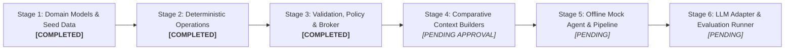

# ShopConnect Implementation Status & Verification Report

**Environment Runtime:** Python 3.14.7 (`.venv`)  
**Package Name:** `shopconnect_env`  
**Current Test Coverage:** 60 Passed / 0 Failed (100% pass rate)
**Last Verification Run:** 2026-11-10
**Master Specification:** [docs/RESEARCH_SPEC.md](RESEARCH_SPEC.md)

---

## 1. Research Objective

The ShopConnect Object-Centric Intelligence Environment investigates whether an LLM can effectively interact with persistent Python domain objects using **compact method signatures and selective progressive disclosure**, rather than repeatedly receiving and regenerating the entire application state on every turn.

The system enforces a strict, deterministic **trust boundary**:
* The LLM acts solely as an untrusted proposer emitting structured JSON payloads.
* Trusted application code parses schemas, stages candidates on isolated clones, enforces dietary/allergen/budget policy gates, recomputes derived projections, and commits or rolls back atomically.

---

## 2. Stage 1 Implementation: Domain Models & Seed Catalog

Stage 1 established the authoritative domain data layer as pure Python `@dataclass` structures with zero dependencies on external frameworks, databases, or language models.

### 2.1 Domain Models ([`src/shopconnect_env/domain/models.py`](../src/shopconnect_env/domain/models.py))

* **`Ingredient` (Frozen Dataclass):** Represents a canonical raw ingredient with a unique string ID (`ingredient_id`), human-readable display name, aisle category, canonical measurement unit, and an optional tuple of verified allergen classifications (`allergens`). Immutability ensures standard units and allergen declarations cannot be modified in place.
* **`IngredientRequirement` (Frozen Dataclass):** Specifies the required quantity (`Decimal`) and unit for an ingredient within a recipe. Provides a pure `scale(factor: Decimal) -> IngredientRequirement` method.
* **`Recipe` (Dataclass):** The blueprint for a meal. Defines `recipe_id`, `name`, dietary/meal `tags`, `default_servings`, `estimated_cost` (in USD using `Decimal`), and a list of `requirements`. Exposes a computed property `cost_per_serving = estimated_cost / Decimal(default_servings)`.
* **`Meal` (Dataclass):** Represents a scheduled slot. Associates a calendar day (`'Monday'`–`'Sunday'`) and meal type (`'breakfast'`, `'lunch'`, `'dinner'`) with a `recipe_id` and specific portion size (`servings`). Exposes `slot_key` (e.g., `'Wednesday_dinner'`) and `calculate_cost(recipe)`.
* **`UserPreferences` (Dataclass):** Encapsulates household constraints: required `diet_tags` (e.g., `['vegetarian']`), excluded `allergies` (e.g., `['peanuts']`), a positive `weekly_budget` (`Decimal`), and `household_size`.
* **`MealPlan` (Dataclass):** The central state entity representing the full 7-day schedule (up to 21 distinct slots). Tracks monotonic `plan_version`, preferences, and meal slots. Provides `set_meal()`, `get_meal(day, meal_type)`, `is_complete()`, and `calculate_total_cost(catalog)`.
* **`GroceryItem` (Frozen Dataclass):** Represents an aggregated shopping item containing canonical ID, display name, aisle category, total quantity (`Decimal`), and unit.
* **`GroceryBasket` (Frozen Dataclass):** An immutable, purely derived projection of ingredients required by all active meals in a `MealPlan`. Enforces the critical research rule that **the grocery basket is never directly editable by an LLM**.

### 2.2 Seed Catalog ([`data/catalog_seed.json`](../data/catalog_seed.json))

A curated dataset containing:
* **31 Canonical Ingredients:** Covering produce, grains, legumes, dairy, plant proteins, meats, seafood, oils, and seasonings with standardized units (`g`, `ml`, `unit`, `slice`) and canonical allergen classifications (`peanuts`, `tree_nuts`, `eggs`, `dairy`, `soy`, `wheat`, `gluten`, `fish`).
* **18 Realistic Recipes:** Spanning breakfasts, lunches, and dinners, with diverse dietary tags (`vegetarian`, `vegan`, `gluten-free`, `dairy-free`, `high-protein`, `quick`) and documented costs.
* **Referential Integrity Loader:** `load_catalog_from_json(path)` validates that every recipe requirement references an existing canonical ingredient ID, normalizes allergens into immutable tuples, and converts all numerical values to `Decimal`.

---

## 3. Stage 2 Implementation: Deterministic Operations & Derived Basket

Stage 2 implemented deterministic state mutations and pure derived state recalculation, ensuring strict candidate state isolation.

### 3.1 State Mutations ([`src/shopconnect_env/operations/mutations.py`](../src/shopconnect_env/operations/mutations.py))

* **`apply_replace_meal(plan, day, meal_type, recipe_id, catalog, servings=None)`:**
  * Validates slot key formatting via `make_slot_key(day, meal_type)`.
  * Verifies target `recipe_id` exists in the recipe catalog (raises `KeyError` if missing).
  * Validates serving portion (must be a positive integer; defaults to `recipe.default_servings` if omitted).
  * **Candidate Staging:** Uses `copy.deepcopy(plan)` to isolate changes.
  * Mutates only the target slot; leaves all 20 other slots byte-identical.
  * Increments `plan_version` on the returned candidate.
* **`apply_change_servings(plan, day, meal_type, servings)`:**
  * Verifies the target slot is currently scheduled (raises `KeyError` if empty).
  * Validates that `servings` is a positive integer.
  * Clones the plan, modifies portion size, and advances `plan_version`.

### 3.2 Derived Basket Aggregator ([`src/shopconnect_env/operations/basket_calculator.py`](../src/shopconnect_env/operations/basket_calculator.py))

* **`calculate_grocery_basket(plan, catalog, ingredients)`:**
  * Pure calculation engine that inspects every scheduled meal in the provided `MealPlan`.
  * Evaluates scaling ratio:
    $$\text{scale\_factor} = \frac{\text{meal.servings}}{\text{recipe.default\_servings}}$$
  * Multiplies each requirement by $\text{scale\_factor}$ with exact `Decimal` precision.
  * Aggregates identical ingredients across different recipes (e.g., spinach in an omelet and pasta).
  * Verifies unit compatibility across recipes (raises `ValueError` on unit conflict).
  * Verifies referential integrity (raises `KeyError` if a recipe or ingredient is missing from catalogs).
  * Sorts output items alphabetically by `ingredient_id` for deterministic, reproducible comparisons.
  * Returns an immutable `GroceryBasket` with `basket_version == plan.plan_version`.

---

## 4. Stage 3 Implementation: Validation, Policy Engine & Action Broker

Stage 3 established the deterministic safety and transactional coordination layer that governs all interactions with domain state.

### 4.1 Pydantic Action Schemas ([`src/shopconnect_env/validation/schemas.py`](../src/shopconnect_env/validation/schemas.py))

* **`OperationType` (Enum):** Explicit allowlist of permissible operations: `replace_meal`, `change_servings`, and `inspect_object`.
* **`ReplaceMealArgs` & `ChangeServingsArgs`:** Strict models configured with `ConfigDict(extra="forbid")`. Enforces valid day (`DAYS_OF_WEEK`), valid slot (`MEAL_TYPES`), non-empty recipe IDs, and positive integer servings. Explicitly rejects floats (e.g., `2.5`, `3.0`) and booleans (`True`, `False`).
* **`InspectObjectArgs`:** Defines queries against entity categories (`recipe`, `meal`, `plan`, `preferences`, `ingredient`).
* **`ActionProposal`:** Root schema ingesting untrusted agent proposals from JSON strings or Python dictionaries. Validates that arguments strictly conform to the declared operation. Supports `expected_plan_version` for stale-state protection and requires a human-readable `reason`.
* **`ActionResult`:** Standardized return payload capturing execution status (`COMMITTED` vs `REJECTED`), version deltas, execution duration in milliseconds, rejection reasons, and diagnostic details.

### 4.2 Policy Engine ([`src/shopconnect_env/validation/policy_engine.py`](../src/shopconnect_env/validation/policy_engine.py))

* **Dietary Restrictions:** Validates that every scheduled recipe satisfies all configured `UserPreferences.diet_tags` (with support for implicit tags such as `vegan` implying `vegetarian` and `dairy-free`).
* **Allergen Safety & Conservative Handling:**
  * Normalizes aliases across common categories (e.g., `peanut`/`peanuts`, `milk`/`dairy`, `wheat`/`gluten`, `egg`/`eggs`, `nut`/`tree_nuts`).
  * Cross-references ingredient requirements against user allergies.
  * **Conservative Rule:** If an ingredient has unknown allergen metadata (`allergens is None`) while the user has active allergy constraints, the recipe is conservatively rejected.
* **Weekly Budget Enforcement:** Recomputes projected total costs of all scheduled meals using `Decimal` arithmetic. Rejects candidates that exceed `UserPreferences.weekly_budget`.
* **State Invariant Validation:** Asserts that user preferences are unchanged, the plan version increments exactly by 1, non-target slots remain byte-identical, and no unauthorized meal slots are created.

### 4.3 Action Broker & Atomic State Management ([`src/shopconnect_env/validation/broker.py`](../src/shopconnect_env/validation/broker.py))

* **Private Runtime State (`RuntimeState`):** Holds private, immutable references to the authoritative `MealPlan` and matching `GroceryBasket`.
* **State Encapsulation:** `get_plan()` returns an isolated `copy.deepcopy()` snapshot so external callers cannot mutate internal state.
* **Atomic Transaction Lifecycle:**
  1. Ingests raw proposal, JSON string, or dictionary.
  2. Parses schema; rejects malformed syntax, extra fields, or unsupported operations.
  3. Validates `expected_plan_version` against authoritative state; rejects stale requests.
  4. Stages candidate `MealPlan` using deterministic operations (`apply_replace_meal`, `apply_change_servings`).
  5. Evaluates pre-commit policy rules (dietary, allergen, budget, invariants).
  6. Recalculates derived `GroceryBasket`.
  7. Verifies postconditions (basket version matches plan version).
  8. Commits state atomically via a single reference swap (`self._state = RuntimeState(...)`).
  9. On any error, aborts transaction immediately. Authoritative state remains completely untouched.

---

## 5. Current Function & Module Catalog

| Module | Implemented Class / Function | Signature | Operational Role |
| :--- | :--- | :--- | :--- |
| `domain.models` | `make_slot_key` | `(day: str, meal_type: str) -> str` | Canonical slot identifier (e.g. `'Monday_breakfast'`). |
| `domain.models` | `Ingredient` | `@dataclass(frozen=True)` | Immutable canonical grocery item with allergen tuple. |
| `domain.models` | `IngredientRequirement` | `@dataclass(frozen=True)` | Quantity, unit, and `scale(factor)` method. |
| `domain.models` | `Recipe` | `@dataclass` | Recipe definition, tags, and `cost_per_serving`. |
| `domain.models` | `Meal` | `@dataclass` | Scheduled slot, servings, and `calculate_cost`. |
| `domain.models` | `UserPreferences` | `@dataclass` | Dietary tags, allergen exclusions, and budget cap. |
| `domain.models` | `MealPlan` | `@dataclass` | 7-day schedule, 21 slots, `plan_version`. |
| `domain.models` | `GroceryBasket` | `@dataclass(frozen=True)` | Immutable derived shopping list. |
| `domain.models` | `load_catalog_from_json` | `(filepath: Path \| str) -> Tuple[Dict, Dict]` | Parses seed JSON into typed models with `Decimal`. |
| `operations.mutations` | `apply_replace_meal` | `(plan, day, meal_type, recipe_id, catalog, servings=None) -> MealPlan` | Pure meal slot replacement on cloned candidate. |
| `operations.mutations` | `apply_change_servings` | `(plan, day, meal_type, servings: int) -> MealPlan` | Pure portion size scaling on cloned candidate. |
| `operations.basket_calculator` | `calculate_grocery_basket` | `(plan, catalog, ingredients) -> GroceryBasket` | Pure, deterministic grocery aggregation engine. |
| `validation.schemas` | `ReplaceMealArgs` | `BaseModel` | Validates replace_meal arguments with strict type checks. |
| `validation.schemas` | `ChangeServingsArgs` | `BaseModel` | Validates change_servings arguments with strict integer checks. |
| `validation.schemas` | `InspectObjectArgs` | `BaseModel` | Validates read-only object inspection queries. |
| `validation.schemas` | `ActionProposal` | `BaseModel` | Validates incoming action proposal payloads. |
| `validation.schemas` | `ActionResult` | `BaseModel` | Authoritative transaction execution result. |
| `validation.policy_engine` | `PolicyEngine` | `class` | Deterministic dietary, allergen, budget, and invariant checker. |
| `validation.broker` | `ActionBroker` | `class` | Transaction staging, atomic commit, and rollback coordinator. |

---

## 6. Verification: Passing Automated Test Suite

Executed via `.\.venv\Scripts\python.exe -m pytest -v`:

```text
============================= test session starts =============================
platform win32 -- Python 3.14.7, pytest-9.2.0, pluggy-1.7.0 -- .venv\Scripts\python.exe
rootdir: C:\Users\deepu\OneDrive\Desktop\shopconnect-object-env
configfile: pytest.ini
testpaths: tests
collecting ... collected 53 items

tests/test_action_broker.py::test_successful_meal_replacement PASSED     [  1%]
tests/test_action_broker.py::test_successful_serving_update PASSED       [  3%]
tests/test_action_broker.py::test_non_target_meals_preserved_on_commit PASSED [  5%]
tests/test_action_broker.py::test_malformed_proposals_rejected PASSED    [  7%]
tests/test_action_broker.py::test_unsupported_operations_rejected PASSED [  9%]
tests/test_action_broker.py::test_dietary_violations_rejected PASSED     [ 11%]
tests/test_action_broker.py::test_allergen_violations_rejected PASSED    [ 13%]
tests/test_action_broker.py::test_budget_violations_rejected PASSED      [ 15%]
tests/test_action_broker.py::test_stale_proposals_rejected PASSED        [ 16%]
tests/test_action_broker.py::test_recalculation_failure_does_not_partially_commit PASSED [ 18%]
tests/test_action_broker.py::test_authoritative_state_cannot_be_mutated_via_exposed_snapshots PASSED [ 20%]
tests/test_domain_models.py::test_ingredient_creation PASSED             [ 22%]
tests/test_domain_models.py::test_ingredient_requirement_and_scaling PASSED [ 24%]
tests/test_domain_models.py::test_recipe_cost_per_serving PASSED         [ 26%]
tests/test_domain_models.py::test_meal_slot_keys_and_validation PASSED   [ 28%]
tests/test_domain_models.py::test_meal_cost_calculation PASSED           [ 30%]
tests/test_domain_models.py::test_meal_plan_slot_representation PASSED   [ 32%]
tests/test_domain_models.py::test_user_preferences_defaults PASSED       [ 33%]
tests/test_domain_models.py::test_load_catalog_seed PASSED               [ 35%]
tests/test_domain_models.py::test_derived_grocery_basket_calculation PASSED [ 37%]
tests/test_operations.py::test_replace_wednesday_dinner PASSED           [ 39%]
tests/test_operations.py::test_other_slots_remain_unchanged PASSED       [ 41%]
tests/test_operations.py::test_change_servings PASSED                    [ 43%]
tests/test_operations.py::test_ingredient_quantity_scaling PASSED        [ 45%]
tests/test_operations.py::test_aggregating_shared_ingredients PASSED     [ 47%]
tests/test_operations.py::test_missing_recipe_id_error PASSED            [ 49%]
tests/test_operations.py::test_unknown_meal_slot_error PASSED            [ 50%]
tests/test_operations.py::test_invalid_serving_counts PASSED             [ 52%]
tests/test_operations.py::test_original_plan_unchanged_on_failure PASSED [ 54%]
tests/test_operations.py::test_recalculate_basket_after_replacement PASSED [ 56%]
tests/test_policy_engine.py::test_vegetarian_recipe_allowed PASSED       [ 58%]
tests/test_policy_engine.py::test_non_vegetarian_recipe_rejected PASSED  [ 60%]
tests/test_policy_engine.py::test_multiple_dietary_constraints PASSED    [ 62%]
tests/test_policy_engine.py::test_peanut_allergy_rejects_peanut_recipe PASSED [ 64%]
tests/test_policy_engine.py::test_known_non_matching_allergen_allowed PASSED [ 66%]
tests/test_policy_engine.py::test_unknown_allergen_metadata_conservatively_rejected PASSED [ 67%]
tests/test_policy_engine.py::test_budget_compliant_candidate PASSED      [ 69%]
tests/test_policy_engine.py::test_budget_exceeding_candidate_rejected PASSED [ 71%]
tests/test_policy_engine.py::test_missing_recipe_reference_in_plan PASSED [ 73%]
tests/test_policy_engine.py::test_incomplete_plan_cost_semantics_documented PASSED [ 75%]
tests/test_policy_engine.py::test_invariant_validation_detects_unintended_changes PASSED [ 77%]
tests/test_validation_schemas.py::test_valid_replace_meal_proposal PASSED [ 79%]
tests/test_validation_schemas.py::test_valid_change_servings_proposal PASSED [ 81%]
tests/test_validation_schemas.py::test_malformed_json PASSED             [ 83%]
tests/test_validation_schemas.py::test_unknown_operation PASSED          [ 84%]
tests/test_validation_schemas.py::test_missing_required_arguments PASSED [ 86%]
tests/test_validation_schemas.py::test_unexpected_fields_forbidden PASSED [ 88%]
tests/test_validation_schemas.py::test_invalid_day_and_meal_type PASSED  [ 90%]
tests/test_validation_schemas.py::test_zero_and_negative_servings_rejected PASSED [ 92%]
tests/test_validation_schemas.py::test_float_and_boolean_servings_explicitly_rejected PASSED [ 94%]
tests/test_validation_schemas.py::test_wrong_argument_schema_for_operation PASSED [ 96%]
tests/test_validation_schemas.py::test_stale_version_field_parsing PASSED [ 98%]
tests/test_validation_schemas.py::test_inspect_object_args_validation PASSED [100%]

============================= 60 passed in 0.57s ==============================
```

---

## 7. Implementation Roadmap & Current Status



| Stage | Focus Area | Status | Implemented / Planned Modules |
| :--- | :--- | :---: | :--- |
| **Stage 1** | Core Domain Models & Seed Catalog | **Completed** | `domain/models.py`, `catalog_seed.json` |
| **Stage 2** | Deterministic Operations & Basket Math | **Completed** | `operations/mutations.py`, `operations/basket_calculator.py` |
| **Stage 3** | Validation, PolicyEngine & ActionBroker | **Completed** | `validation/schemas.py`, `validation/policy_engine.py`, `validation/broker.py` |
| **Stage 4** | Comparative Context Strategies (A, B, C) | *Pending Approval* | `context/full_state.py`, `context/tool_context.py`, `context/object_context.py` |
| **Stage 5** | Offline Mock Agent & Test Pipeline | *Pending* | `agents/base.py`, `agents/mock_agent.py`, `tests/test_offline_pipeline.py` |
| **Stage 6** | Real LLM Adapter, Tasks & Benchmark Runner | *Pending* | `agents/llm_adapter.py`, `evaluation/runner.py`, `results/comparison.csv` |

---

## 8. Current System Limitations & Scientific Boundaries

1. **Synthetic Allergen Metadata Limitation:** Allergen classifications in `data/catalog_seed.json` are synthetic test representations. In real applications, allergen verification requires live manufacturer API feeds and physical product packaging review.
2. **Cross-Contamination Not Modeled:** Shared production line warnings ("may contain traces of...") are outside the current data model scope.
3. **Incomplete-Plan Cost Semantics:** If a meal plan has empty slots, `calculate_total_cost()` sums only scheduled meals. The resulting value represents current planned spend, not full weekly household expenditure.
4. **No LLM Integration Yet:** The system runs fully offline; context serialization (Conditions A, B, C) and LLM adapters will be added in Stages 4 and 5.
5. **In-Memory Storage:** The runtime state resides in Python process memory.
