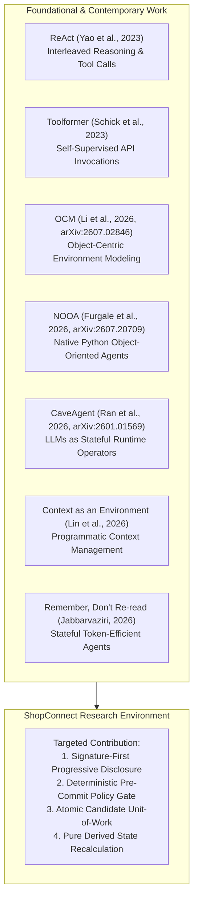
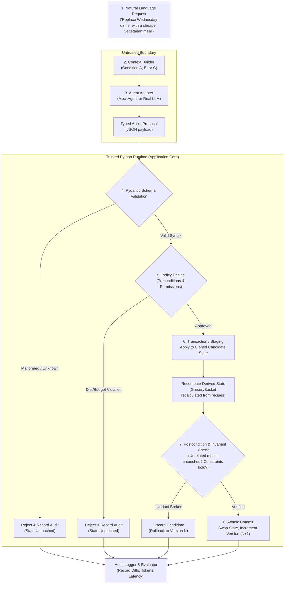
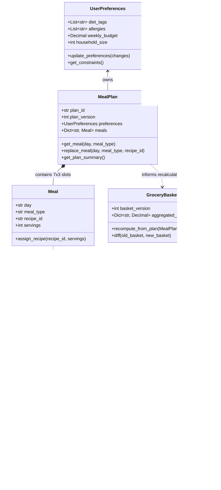
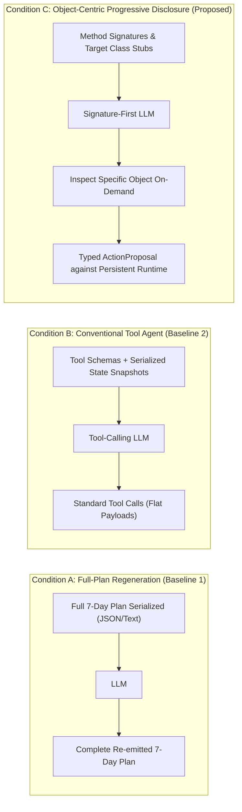
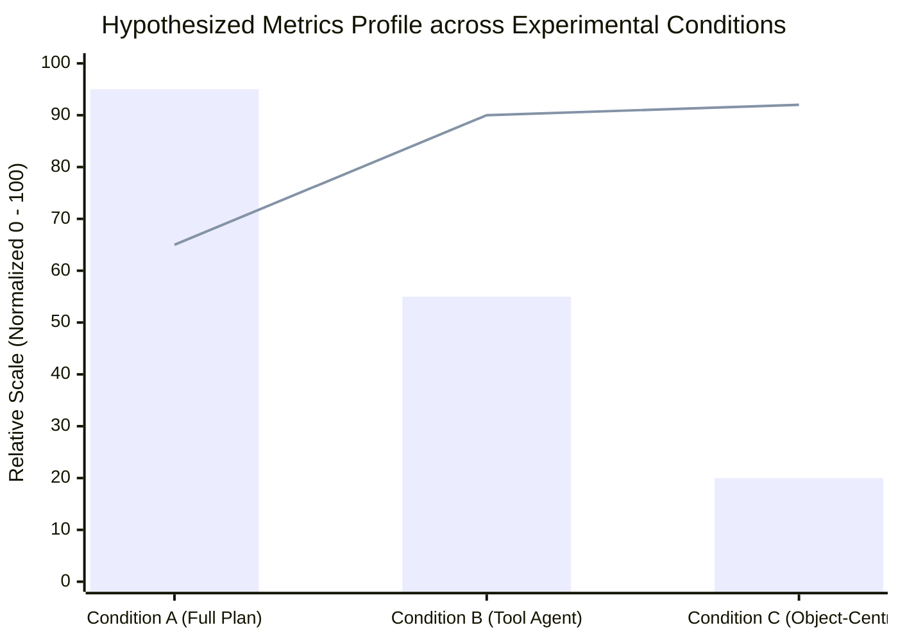
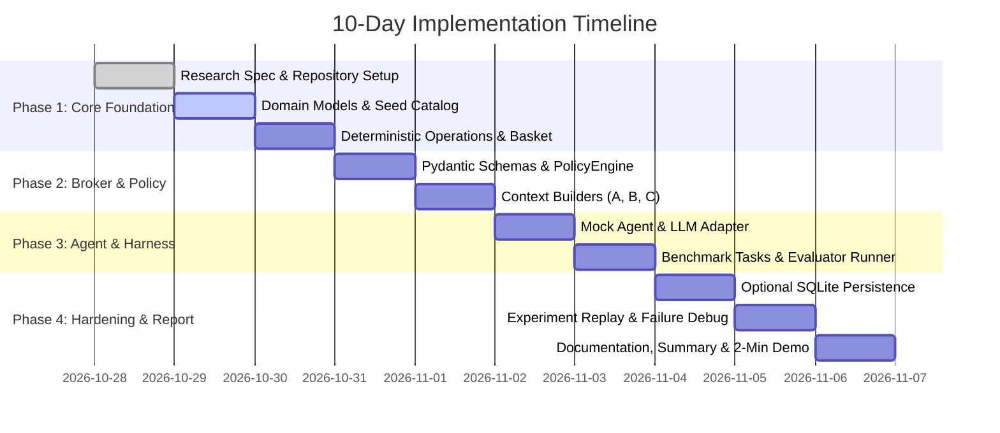
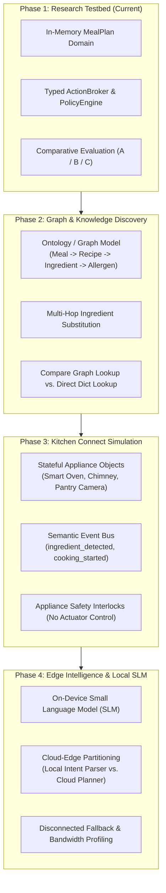

# ShopConnect Object-Centric Research Environment (Phase 1)
## Comprehensive Architecture, Experimental Design & Implementation Blueprint

---

## 1. Executive Summary & Research Charter

### 1.1 Purpose & Mission
The **ShopConnect Object-Centric Research Environment** is a controlled, deterministic Python research testbed designed to evaluate whether **persistent domain objects with progressive signature disclosure** outperform conventional LLM interaction paradigms (broad full-state regeneration and flat tool-calling agents) in stateful, multi-step meal-planning tasks.

The system enforces an uncompromising architectural principle: **The LLM proposes actions; trusted application code owns state and verifies all business invariants.**

```
+---------------------------------------------------------------------------------------+
|                                    TRUST BOUNDARY                                     |
|                                                                                       |
|   +-----------------------+              ActionProposal             +-------------+   |
|   |   LLM Agent / Model   | --------------------------------------> |  Pydantic   |   |
|   |  (Untrusted Proposer) | <-------------------------------------- |   Schema    |   |
|   +-----------------------+           ActionResult / Reject         +------+------+   |
|                                                                            |          |
| ===========================================================================|========= |
|                                                                            v          |
|   +-------------------------------------------------------------------------------+   |
|   |                       Deterministic Application Core                          |   |
|   |                                                                               |   |
|   |   +-------------------+    +---------------------+    +-------------------+   |   |
|   |   |   Policy Engine   | -> | Candidate Staging   | -> | Transaction Commit|   |   |
|   |   |  (Preconditions)  |    | & Derived Recalc    |    | & Postconditions  |   |   |
|   |   +-------------------+    +---------------------+    +-------------------+   |   |
|   |                                                                               |   |
|   |   +-----------------------------------------------------------------------+   |   |
|   |   |                Persistent State Store (Source of Truth)               |   |   |
|   |   |  [MealPlan v(N)]  <-->  [Meals / Recipes]  --->  [Derived Grocery]   |   |   |
|   |   +-----------------------------------------------------------------------+   |   |
|   +-------------------------------------------------------------------------------+   |
+---------------------------------------------------------------------------------------+
```

### 1.2 Core Research Questions

* **Primary Research Question (RQ1):**
  > Can a persistent object-centric runtime with selective context and typed operations reduce unnecessary LLM context without degrading state correctness, constraint preservation, or task completion rates in multi-step meal-planning workflows?
* **Secondary Research Questions:**
  * **RQ2 (Token & Cost Efficiency):** Compared to conventional tool-calling agents, does selective object/method signature disclosure decrease input prompt tokens, total token consumption, wall-clock latency, and monetary cost?
  * **RQ3 (State Preservation):** Does explicit domain object encapsulation reduce the *unintended mutation rate* (i.e., accidental drift or clobbering of unmentioned meals and requirements) relative to full-plan regeneration?
  * **RQ4 (Failure Dynamics & Recovery):** What specific failure modes emerge from selective context (e.g., retrieval omissions, stale state, misrouted parameters), and can a deterministic policy gate safely intercept them with zero accepted violations?

### 1.3 Hypotheses & Evidence Requirements

| Hypothesis ID | Statement | Required Empirical Evidence |
| :--- | :--- | :--- |
| **H1 — Context Efficiency** | Exposing compact method signatures first and retrieving object details on demand reduces input context size and cumulative tokens compared to repeatedly serializing the entire plan. | Provider-reported input/output token counts, raw serialized context byte sizes, and call counts across identical benchmark tasks. |
| **H2 — State Correctness** | Encapsulated, targeted operations preserve unrelated meal-plan state significantly better than full-plan textual regeneration. | Exact state diffs comparing expected vs. actual post-states; measurement of unintended mutation rates across all non-target slots. |
| **H3 — Invariant Enforcement** | A deterministic pre-commit validation boundary strictly prevents forbidden or constraint-violating operations from modifying authoritative state. | Rejection tests against adversarial/invalid inputs; target is **0 committed violations** in the protected execution pipeline. |
| **H4 — System Trade-offs** | Any token or context savings achieved via selective disclosure must not come at the cost of lower task success or unacceptable latency spikes from excessive round trips. | Joint reporting of task success rate, false rejection rate, call volume, and p50/p95 wall-clock latency. |

---

## 2. Research Positioning & Prior Art

> [!NOTE]
> Object-oriented programming, typed tool calling, and business-rule validation are established software engineering practices. The academic and engineering value of this project comes from isolating the **context-management mechanism** and conducting a rigorous, controlled comparative evaluation.

### 2.1 Academic Lineage
The architecture builds upon recent breakthroughs in stateful and object-oriented agent runtimes:



* **OCM & NOOA:** Emphasize that models perform better when interfacing with structured object abstractions rather than monolithic text buffers or flat REST-style endpoints.
* **CaveAgent & Remember, Don't Re-read:** Demonstrate that agents lose accuracy and consume excessive tokens when forced to re-read and re-emit unchanged state on every turn.
* **ShopConnect Differentiation:** Unlike systems allowing arbitrary code execution (`exec()` / `eval()`), ShopConnect establishes a **strict sandboxed trust boundary** using allowlisted Pydantic action proposals, transactional candidate copies, and automated downstream derived-state recalculations.

---

## 3. System Architecture & Request Lifecycle

### 3.1 Layered Runtime Topology



### 3.2 End-to-End Execution Flow (Step-by-Step)

```sequenceDiagram
    autonumber
    actor User as User / Task Fixture
    participant CB as ContextBuilder (A/B/C)
    participant LLM as Agent Adapter (LLM/Mock)
    participant Broker as ActionBroker
    participant Policy as PolicyEngine
    participant State as Authoritative StateStore
    participant Basket as GroceryBasket Service
    participant Audit as Audit & Evaluator

    User->>CB: Send Task Request ("Swap Wed dinner to veg")
    CB->>State: Inspect necessary state (or full state if Cond A)
    State-->>CB: State view / Signatures
    CB->>LLM: Render prompt with Context
    LLM-->>Broker: Propose ActionProposal (JSON)
    Broker->>Broker: Pydantic Schema Validation
    alt Schema Invalid
        Broker->>Audit: Log Parse Rejection (Delta = 0)
        Broker-->>User: ActionResult(status=REJECTED, reason=...)
    else Schema Valid
        Broker->>Policy: Validate Preconditions (Diet, Catalog check)
        alt Policy Fails
            Policy-->>Broker: Violation Detected
            Broker->>Audit: Log Policy Rejection (Delta = 0)
            Broker-->>User: ActionResult(status=REJECTED, reason=...)
        else Policy Passes
            Broker->>State: Clone Candidate State (Unit-of-Work)
            Broker->>State: Apply mutation to Candidate only
            Broker->>Basket: Recompute GroceryBasket from active recipes
            Broker->>Policy: Verify Postconditions (Unchanged meals intact, Invariants hold)
            alt Invariants Fail
                Broker->>State: Discard Candidate
                Broker->>Audit: Log Invariant Rejection (Delta = 0)
                Broker-->>User: ActionResult(status=REJECTED, reason=...)
            else Invariants Pass
                Broker->>State: Atomic Commit (Version N -> N+1)
                Broker->>Audit: Log Success (State Delta, Tokens, Latency)
                Broker-->>User: ActionResult(status=COMMITTED, version=N+1)
            end
        end
    end
```

### 3.3 Core Trust & State Ownership Rules

1. **Authoritative Source of Truth:** Live application state is exclusively held in Python in-memory objects (and optionally backed by SQLite). The LLM context is strictly an ephemeral *view* and never the database of record.
2. **Read vs. Write Segregation:** Reading and inspection functions return data; state transitions occur solely via allowlisted command handlers.
3. **No Dynamic Arbitrary Code Execution:** Strictly forbid `exec()`, `eval()`, or raw code execution. The agent can only emit structured parameters targeting pre-registered operations.
4. **All-or-Nothing Atomic Commits:** Candidate state changes and downstream derived recalculations (e.g., `GroceryBasket`) must succeed jointly or revert to the prior state snapshot cleanly.
5. **Progressive Disclosure:** Expose class and method signatures first; retrieve attributes or recipe requirements only when specifically requested by the active task.

---

## 4. Domain Model & Dependency Architecture

The domain represents a realistic yet bounded meal-planning and grocery ecosystem. Relationships are explicitly modeled in Python dataclasses.



### 4.1 Dependency-Aware Updates & Invariant Boundary

When an operation modifies domain state, downstream dependencies must update deterministically while unrelated branches remain completely untouched:

| Trigger Event | Downstream Recalculations | Invariants to Preserve |
| :--- | :--- | :--- |
| **`replace_meal(day, slot, new_recipe)`** | 1. Recalculate Wednesday ingredient list.<br>2. Re-aggregate entire `GroceryBasket`.<br>3. Recalculate estimated weekly plan cost.<br>4. Re-verify dietary/allergen constraints. | • All other 20 meal slots (Monday through Sunday) remain byte-identical.<br>• Unchanged recipe serving sizes stay constant.<br>• Existing user preference profiles are preserved. |
| **`change_servings(recipe_id, servings)`** | 1. Scale `IngredientRequirement` amounts proportionally.<br>2. Re-aggregate `GroceryBasket` totals.<br>3. Check budget constraint against new total cost. | • Meal assignments across days remain unchanged.<br>• Baseline recipe definitions in catalog remain unmutated. |
| **`update_preferences(new_diet)`** | 1. Audit entire current `MealPlan` against new diet rules.<br>2. Flag conflicts or trigger clarification flow. | • Historical plan versions and non-conflicting meals preserved. |

> [!CAUTION]
> **Anti-Pattern Warning:** Never allow the LLM to generate or mutate the `GroceryBasket`. The grocery basket is a *derived projection* of active meals and recipe requirements. Allowing the LLM to write directly to the basket introduces hallucinations, duplicate items, and inconsistent units.

---

## 5. Experimental Design & Methodology

To ensure that performance differences are attributable to context architecture rather than model capabilities, three experimental conditions are executed across identical benchmarks.



### 5.1 Comparative Conditions Matrix

| Parameter | Condition A: Full-State Regeneration | Condition B: Conventional Tool Agent | Condition C: Object-Centric (Proposed) |
| :--- | :--- | :--- | :--- |
| **Initial Prompt Payload** | Full 7-day meal plan, all recipe names, ingredients, and basket serialized. | Standard OpenAI/Anthropic tool schemas + serialized state snapshots. | Compact class/method signatures (`MealPlan.replace_meal(...)`), user preferences, target slot summary. |
| **Model Action Modality** | Emits complete updated JSON/Markdown plan document. | Emits standard tool call invocations (`call: replace_meal(...)`). | Emits typed `ActionProposal` targeting persistent objects; inspects sub-objects if needed. |
| **Context Expansion** | High static context ($O(N)$ with entire state size). | Medium context (tool definitions + state snapshots per turn). | Minimal initial context ($O(1)$ signatures); expands selectively on demand. |
| **State Mutation Mechanism** | Application replaces entire plan with model-generated plan. | Tool execution mutates state via service functions. | Allowlisted broker executes change on candidate object; atomic commit. |
| **What It Isolates** | Cost and brittleness of regenerating unmutated state. | Strong, standard tool-calling industry baseline. | Incremental benefit of persistent state + progressive disclosure. |

### 5.2 Controlled Experimental Variables

* **Model & Provider:** Frozen model version (e.g., `gemini-1.5-pro`, `gpt-4o`, or local equivalent), fixed temperature ($T = 0.0$), identical system prompt safety rules.
* **Seed Data & Fixtures:** Identical synthetic catalog of 15–20 recipes, fixed starting weekly plans, and identical constraint definitions.
* **Deterministic Policy Gate:** The exact same `PolicyEngine` validates changes in all three conditions. (In Condition A, the regenerated plan is diffed and evaluated against the policy rules).
* **Evaluation Oracle:** Deterministic Python assertions define task pass/fail. The LLM is **never** used as an evaluator of its own output.

---

## 6. Evaluation Framework & Metric Definitions

### 6.1 Formal Metrics Portfolio


*(Blue bars: Input Context Size / Tokens; Orange line: State Preservation Accuracy)*

| Metric Name | Formal Definition | Operational Calculation | Target Value |
| :--- | :--- | :--- | :--- |
| **Task Success Rate ($R_{\text{success}}$)** | Fraction of tasks where requested change is accurately made and all postconditions pass. | $\frac{N_{\text{passed}}}{N_{\text{total}}}$ | $\ge 90\%$ |
| **Target Change Accuracy ($A_{\text{target}}$)** | Correct operation, day, meal slot, and valid replacement recipe selected. | $\frac{N_{\text{correct\_target}}}{N_{\text{total}}}$ | $\ge 95\%$ |
| **Unintended Mutation Rate ($R_{\text{drift}}$)** | Fraction of tasks where non-target state (unrelated meals, unchanged recipes) mutated. | $\frac{N_{\text{drift\_detected}}}{N_{\text{total}}}$ | **$0.0\%$** in Condition C |
| **Committed Violation Count ($V_{\text{commit}}$)** | Number of invalid or forbidden states that successfully bypassed the gate. | Absolute count across all runs | **Strictly 0** |
| **False Rejection Rate ($R_{\text{false\_reject}}$)** | Valid, legal user requests rejected erroneously by the policy engine. | $\frac{N_{\text{false\_rejections}}}{N_{\text{valid\_requests}}}$ | $\le 2.0\%$ |
| **Input Context Volume ($T_{\text{in}}$)** | Billed input tokens required to complete the task interaction. | Provider API token usage counter | Significant reduction vs A & B |
| **Interaction Latency ($L_{\text{p50}} / L_{\text{p95}}$)** | End-to-end wall-clock time from user request to committed state. | Stopwatch timer ($t_{\text{end}} - t_{\text{start}}$) in milliseconds | Bounded; no exponential blowup |

### 6.2 Benchmark Task Suite (20–30 Standard Test Cases)

The evaluation suite exercises 10 distinct task archetypes:

```
+-----------------------------------------------------------------------------------------+
|                               BENCHMARK TASK ARCHETYPES                                 |
+-----------------------------------------------------------------------------------------+
|  1. Single-Target Edit       Swap Wednesday dinner for a valid alternative recipe.      |
|  2. Constraint Filtering     Swap a meal to vegetarian; verify all ingredients conform. |
|  3. Budget Optimization      Replace meal with a lower-cost option to meet weekly cap.  |
|  4. Servings Scaling         Scale Tuesday lunch from 2 to 4 servings; verify units.   |
|  5. Derived Aggregation      Verify shared ingredients (e.g., onions) correctly sum.    |
|  6. Unknown Target Error     Attempt to replace a non-existent meal slot (e.g., 2nd dinner).|
|  7. Catalog Missing Error    Attempt to assign an invalid/unregistered recipe_id.      |
|  8. Adversarial Violation    Attempt to assign pork/meat when user profile is vegan.   |
|  9. Ambiguous Intent         Prompt lacks slot or day; agent must clarify, not guess.   |
| 10. Rejection Preservation   On rejection, verify pre/post state hash is 100% identical.|
+-----------------------------------------------------------------------------------------+
```

---

## 7. Concrete Pydantic Schemas & Contracts

### 7.1 Action Proposal & Result Schemas

```python
from decimal import Decimal
from enum import Enum
from typing import Any, Dict, List, Optional
from pydantic import BaseModel, Field, ConfigDict

class OperationType(str, Enum):
    REPLACE_MEAL = "replace_meal"
    UPDATE_PREFERENCES = "update_preferences"
    CHANGE_SERVINGS = "change_servings"
    INSPECT_OBJECT = "inspect_object"

class ReplaceMealArgs(BaseModel):
    model_config = ConfigDict(extra="forbid")
    day: str = Field(..., description="Day of the week (e.g., 'Wednesday')")
    meal_type: str = Field(..., description="Meal slot: 'breakfast', 'lunch', or 'dinner'")
    recipe_id: str = Field(..., description="Unique ID of replacement recipe from catalog")

class ChangeServingsArgs(BaseModel):
    model_config = ConfigDict(extra="forbid")
    day: str
    meal_type: str
    servings: int = Field(..., gt=0, le=20, description="Target serving count")

class InspectObjectArgs(BaseModel):
    model_config = ConfigDict(extra="forbid")
    object_type: str = Field(..., description="'recipe', 'meal', 'plan', or 'preferences'")
    object_id: str = Field(..., description="Identifier of the entity to inspect")

class ActionProposal(BaseModel):
    model_config = ConfigDict(extra="forbid")
    operation: OperationType
    arguments: Dict[str, Any]
    reason: str = Field(..., min_length=5, description="Agent reasoning for the proposal")

class ActionStatus(str, Enum):
    COMMITTED = "COMMITTED"
    REJECTED = "REJECTED"

class ActionResult(BaseModel):
    status: ActionStatus
    operation: OperationType
    plan_version_before: int
    plan_version_after: int
    rejection_reason: Optional[str] = None
    state_delta: Optional[Dict[str, Any]] = None
    execution_time_ms: float
```

### 7.2 Invariant Verification Contract

```python
class TestContract:
    """
    Formal invariant contract:
    Given: Initial meal plan state S_0 with version V_0
    When: Operation Op is proposed with parameters P
    Then (On Commit):
        1. Target meal matches P.recipe_id
        2. Non-target meals in S_1 == non-target meals in S_0
        3. GroceryBasket(S_1) == aggregate(recipes in S_1)
        4. UserPreferences constraints satisfied in S_1
        5. V_1 == V_0 + 1
    Then (On Reject):
        1. S_1 == S_0 (deep equality on entire serialized snapshot)
        2. V_1 == V_0
        3. Rejection reason is explicitly recorded in audit trace
    """
```

---

## 8. Repository Architecture & Layout

The project structure enforces strict separation between domain logic, policy gates, context formatting, and evaluation runners:

```
shopconnect-object-research/
├── pyproject.toml                     # Dependencies: pydantic>=2.7, pytest>=8.0, python-dotenv
├── README.md                          # Reproduction commands, setup, and architecture notes
├── .env.example                       # LLM_API_KEY=replace_me (Strictly no committed secrets)
├── .gitignore                         # .venv/, __pycache__/, .pytest_cache/, results/raw/
│
├── src/
│   └── shopconnect/
│       ├── __init__.py
│       ├── domain/
│       │   ├── __init__.py
│       │   ├── models.py              # UserPreferences, Ingredient, Recipe, Meal, MealPlan
│       │   └── operations.py          # Deterministic state transitions & basket recomputation
│       │
│       ├── policy/
│       │   ├── __init__.py
│       │   └── engine.py              # Precondition rules, budget/diet checks, postcondition verifier
│       │
│       ├── runtime/
│       │   ├── __init__.py
│       │   └── action_broker.py       # Pydantic parsing, candidate copy, atomic commit/rollback
│       │
│       ├── context/
│       │   ├── __init__.py
│       │   ├── full_state.py          # Condition A: Full serialized plan builder
│       │   ├── tool_context.py        # Condition B: Standard tool descriptions & state snapshots
│       │   └── object_context.py      # Condition C: Signature-first & progressive disclosure
│       │
│       ├── agent/
│       │   ├── __init__.py
│       │   ├── schemas.py             # ActionProposal, ActionResult, Typed Argument models
│       │   ├── mock_agent.py          # Deterministic offline mock for CI & zero-cost tests
│       │   └── llm_adapter.py         # Provider adapter (Gemini/OpenAI/Anthropic)
│       │
│       ├── storage/
│       │   ├── __init__.py
│       │   ├── repository.py          # In-memory snapshot & versioned state repository
│       │   └── sqlite_repo.py         # Optional durable persistence & audit log
│       │
│       └── evaluation/
│           ├── __init__.py
│           ├── tasks.py               # JSONL benchmark scenario loader
│           ├── metrics.py             # Accuracy, drift rate, token counters, latency trackers
│           └── runner.py              # CLI harness running Conditions A, B, and C
│
├── tests/
│   ├── unit/
│   │   ├── test_domain_models.py      # Construction, serving scaling, basket aggregation
│   │   ├── test_policy_engine.py      # Diet violations, budget thresholds, invalid recipe IDs
│   │   └── test_context_builders.py   # Signature formatting and selective disclosure checks
│   ├── integration/
│   │   ├── test_action_broker.py      # Candidate staging, commit atomicity, rollback safety
│   │   └── test_mock_pipeline.py      # Offline end-to-end execution without API keys
│   └── evaluation/
│       └── test_task_invariants.py    # Automated invariant assertions across all benchmark tasks
│
├── data/
│   ├── catalog_seed.json              # 15–20 curated recipes with nutritional & cost metadata
│   └── tasks.jsonl                    # 20–30 frozen evaluation task fixtures
│
└── results/
    ├── raw/                           # Timestamped JSONL execution traces per condition
    │   └── run_20261027_120000.jsonl
    ├── comparison.csv                 # Aggregated metrics (Tokens, Drift, Success, Latency)
    └── analysis.md                    # Auto-generated experiment summary & failure taxonomy
```

---

## 9. 10-Day Stepwise Implementation Roadmap



### 9.1 Daily Milestones & Exit Criteria

* **Day 1: Research Charter & Setup**
  * *Deliverable:* Initialized repo, virtual environment, dependencies installed, test runner verified.
  * *Exit Criterion:* `pytest` runs cleanly; one-page design spec approved.
* **Day 2: Domain Entities & Synthetic Data**
  * *Deliverable:* Implement `UserPreferences`, `Ingredient`, `Recipe`, `Meal`, and `MealPlan` dataclasses. Seed 15 recipes.
  * *Exit Criterion:* Can instantiate a 7-day plan, inspect recipes, and compute grocery needs offline.
* **Day 3: Deterministic Operations & Basket Recalculation**
  * *Deliverable:* Implement `replace_meal` and pure derived `recompute_grocery_basket`.
  * *Exit Criterion:* Replacing Wednesday dinner updates the basket correctly; non-target days remain identical.
* **Day 4: Policy Engine & Action Broker**
  * *Deliverable:* Pydantic `ActionProposal`, `PolicyEngine` pre/post-checks, candidate state isolation.
  * *Exit Criterion:* Rejection-safety tests prove invalid operations leave state 100% untouched.
* **Day 5: Context Builders (Conditions A, B, C)**
  * *Deliverable:* Context generators for Full-State (A), Conventional Tools (B), and Object-Centric Signatures (C).
  * *Exit Criterion:* Unit tests confirm Condition C emits compact stubs and handles progressive inspection calls.
* **Day 6: Mock Agent & Structured LLM Adapter**
  * *Deliverable:* Offline `MockAgent` mapping tasks to proposals; optional live LLM adapter behind identical interface.
  * *Exit Criterion:* Complete test suite passes offline without internet access or API tokens.
* **Day 7: Evaluation Runner & Task Fixtures**
  * *Deliverable:* Load 20–30 tasks from `data/tasks.jsonl`; execute across A, B, and C; emit `results/comparison.csv`.
  * *Exit Criterion:* Automated execution produces raw JSONL traces and aggregate metrics across all three conditions.
* **Day 8: Persistence & Audit Hardening (Optional)**
  * *Deliverable:* SQLite-backed state store; schema migration; durable audit event logging.
  * *Exit Criterion:* Restarting the application preserves committed plan versions and audit histories.
* **Day 9–10: Experiment Replication, Failure Taxonomy & Demo**
  * *Deliverable:* Run repeat trials, analyze outlier failure modes, produce final `results/analysis.md`, record 2-minute demo.
  * *Exit Criterion:* Repository is fully reproducible via `README.md` instructions by any engineer.

---

## 10. AI Coding Agent Prompt Playbook

To ensure the AI coding assistant maintains discipline and does not induce architectural drift, the following sequenced prompts must be issued in order.

```
+-----------------------------------------------------------------------------------------+
|                              PROMPT EXECUTION PIPELINE                                  |
|                                                                                         |
|  [Prompt 0: Architectural Alignment & Scoping (No code written yet)]                   |
|                                    |                                                    |
|                                    v                                                    |
|  [Prompt 1: Domain Entities & In-Memory Data Models]                                    |
|                                    |                                                    |
|                                    v                                                    |
|  [Prompt 2: Deterministic State Operations & Derived Basket Logic]                      |
|                                    |                                                    |
|                                    v                                                    |
|  [Prompt 3: Pydantic Action Schema, Policy Engine & Transaction Broker]                 |
|                                    |                                                    |
|                                    v                                                    |
|  [Prompt 4: Comparative Context Builders (Full Plan vs. Signature-First)]               |
|                                    |                                                    |
|                                    v                                                    |
|  [Prompt 5: Deterministic Mock Agent & Structured LLM Provider Adapter]                 |
|                                    |                                                    |
|                                    v                                                    |
|  [Prompt 6: Evaluation Harness, Benchmark Fixtures & Metrics Aggregator]                |
|                                    |                                                    |
|                                    v                                                    |
|  [Prompt 7: Adversarial Hardening, Regression Testing & Audit Defense]                  |
+-----------------------------------------------------------------------------------------+
```

### Detailed Agent Prompts

#### Prompt 0 — Design First, No Code Yet
> "You are a senior Python software architect and patient mentor. Review the Phase 1 research specification for ShopConnect. Do not create or modify any code files yet. Propose the minimal repository structure for Stage 1. Explain the data flow, list all unresolved assumptions, and draft clear acceptance criteria. Ensure domain operations are 100% deterministic and runnable offline. Strictly exclude LangChain, Neo4j, graph databases, web UIs, hardware drivers, and `exec()`/`eval()` execution. Await my approval before writing code."

#### Prompt 1 — Domain Objects Only
> "Implement only the foundational domain models in `src/shopconnect/domain/models.py`: `UserPreferences`, `Ingredient`, `IngredientRequirement`, `Recipe`, `Meal`, and `MealPlan`. Include a small synthetic catalog of 15 seeded recipes in `data/catalog_seed.json`. Use strict type hints, Python dataclasses, and `Decimal` for financial values. Add comprehensive unit tests in `tests/unit/test_domain_models.py` verifying model construction, recipe references, and meal retrieval. Do not add an LLM or database. Run `pytest` and explain the test results in plain English."

#### Prompt 2 — Deterministic Operations
> "Implement the deterministic operation `replace_meal(day: str, meal_type: str, recipe_id: str)` in `src/shopconnect/domain/operations.py`. The function must locate the target meal slot, validate recipe existence, clone the candidate state, update the meal assignment, and recompute the `GroceryBasket` from all active recipes. If an error occurs, the original state and basket must remain strictly unchanged. Add unit tests for successful replacement, invalid slot, unknown recipe ID, and preservation of non-target meals."

#### Prompt 3 — Schema and Policy Broker
> "Implement the Pydantic schemas in `src/shopconnect/agent/schemas.py` and the `ActionBroker` in `src/shopconnect/runtime/action_broker.py`. Create a `PolicyEngine` in `src/shopconnect/policy/engine.py` that enforces dietary tags and budget rules. The `ActionBroker` must parse proposals, validate schema compliance, stage changes on a candidate copy, execute postcondition verification, and commit atomically by incrementing `plan_version`. On failure, the candidate must be discarded with zero state mutation. Add tests verifying that rejected actions cause zero side effects."

#### Prompt 4 — Comparative Context Strategies
> "Implement the context builders in `src/shopconnect/context/`:
> 1. `full_state.py` (Condition A): Serializes the complete 7-day meal plan, all recipe ingredients, and current grocery basket.
> 2. `object_context.py` (Condition C): Exposes compact class/method signatures and provides an inspection method to retrieve attributes only when explicitly requested.
> Add tests ensuring that both builders draw from identical underlying state and that Condition C supports progressive detail disclosure on demand."

#### Prompt 5 — Mock Agent & LLM Adapter
> "Create `MockAgent` in `src/shopconnect/agent/mock_agent.py` that deterministically maps test tasks to valid `ActionProposal` objects so integration tests can execute offline. Next, create `LLMAdapter` in `src/shopconnect/agent/llm_adapter.py` conforming to the same `propose_action(request, context)` protocol. Ensure API keys are loaded strictly from environment variables, secrets are never logged, and all tests execute cleanly without network calls."

#### Prompt 6 — Evaluation Runner & Metrics Harness
> "Implement the benchmark evaluation harness in `src/shopconnect/evaluation/runner.py`. The runner must load task scenarios from `data/tasks.jsonl` and execute Conditions A (Full-plan regeneration), B (Conventional tool agent), and C (Object-centric selective context) against identical starting states. Record task ID, condition, token counts, call count, wall-clock latency, target accuracy, unintended mutations, and constraint violations. Output raw traces to `results/raw/` and aggregate metrics to `results/comparison.csv`."

#### Prompt 7 — Hardening & Cautious Review
> "Perform a rigorous audit of the entire codebase as a skeptical security and reliability engineer. Identify any untested edge cases, accidental in-place mutations, non-atomic commits, stale derived basket states, or misleading metric calculations. Add minimal, targeted regression tests in `tests/integration/` for each identified risk. Verify that the complete test suite passes and generate a summary of remaining system limitations."

---

## 11. Risk Management & Failure Modes

| Risk / Failure Mode | Root Cause | Systemic Mitigation |
| :--- | :--- | :--- |
| **Agent Hallucinates Unrelated Edits** | Full-text regeneration (Condition A) rewrites days it was not asked to touch. | Condition C restricts mutations to allowlisted single-target methods (`replace_meal`). Postcondition checker asserts non-target meal invariance. |
| **Silent Budget / Allergy Violations** | LLM optimizes for cheap ingredients while ignoring severe allergen tags. | Deterministic `PolicyEngine` validates pre-commit; operation is rejected and transaction rolls back before modifying state. |
| **Stale Context / Race Conditions** | Model formulates an action based on cached state while another operation changed version. | State Store maintains monotonic `plan_version`. The broker checks current version against proposal snapshot version prior to commit. |
| **Excessive Round Trips in Condition C** | Ultra-minimal signatures force the agent to make 5+ inspection calls to find simple data. | Measure total calls and latency alongside tokens. Provide rich method docstrings and concise parameter hints to balance discovery with round trips. |
| **Stale Derived Grocery Basket** | Meal plan recipe changes, but the shopping basket retains ingredients from the old recipe. | `GroceryBasket` is treated strictly as a derived view. It is automatically re-aggregated from all active recipes on every commit. |
| **Scope Creep & Over-Engineering** | Prematurely adding Neo4j graphs, camera pipelines, or SLMs. | Strictly freeze Phase 1 scope. Defer all graph databases, vision models, and physical appliance integrations to Phase 2+. |

---

## 12. Mentor Decision Alignment Gates

Before commencing Day 1 implementation, align with the research mentor on the following strategic decisions:

```
+------------------------------------------------------------------------------------------------+
|                                    MENTOR ALIGNMENT GATES                                      |
+------------------------------------------------------------------------------------------------+
|  1. Domain Slicing:                                                                            |
|     Is meal planning and derived grocery generation the optimal domain slice, or should        |
|     another vertical (e.g., pantry inventory restocking) take precedence?                      |
|                                                                                                |
|  2. Baseline Prioritization:                                                                   |
|     Should all three conditions (A, B, C) be implemented concurrently in sprint 1, or should   |
|     the team prioritize isolating B (Conventional Tools) vs. C (Object-Centric) first?         |
|                                                                                                |
|  3. Approved LLM Provider & Budget Caps:                                                        |
|     Which model family (e.g., Gemini 1.5 Pro/Flash, GPT-4o) is authorized, and what is the     |
|     maximum token/monetary spend ceiling for the evaluation benchmark runs?                   |
|                                                                                                |
|  4. Hard Policy Constraint Selection:                                                          |
|     Which specific business rules must serve as non-negotiable hard constraints during Stage 1  |
|     (e.g., strict allergen exclusion, maximum weekly spend, single-meal calorie bounds)?       |
|                                                                                                |
|  5. Target Deliverable Format:                                                                 |
|     Is the expected deliverable at Day 10 a runnable code demo with preliminary CSV data,       |
|     or a formal research experiment paper draft with statistical significance analysis?        |
+------------------------------------------------------------------------------------------------+
```

---

## 13. Future Extension Roadmap (Phases 2–4)



> [!WARNING]
> **Safety Boundary for Physical Appliance Extensions:**
> When extending the environment to Kitchen Connect smart appliances in Phase 3, **never** allow automated LLM proposals to actuate heating elements, gas valves, or motor drives directly. All simulated device interactions must operate through deterministic, independent physical safety interlocks with human confirmation gates.
